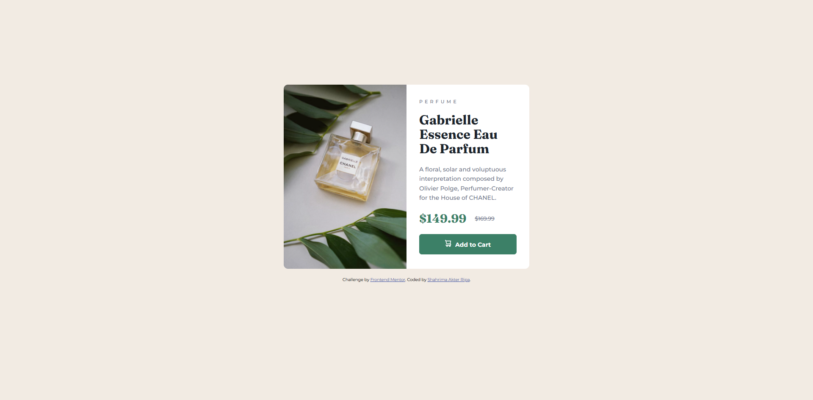
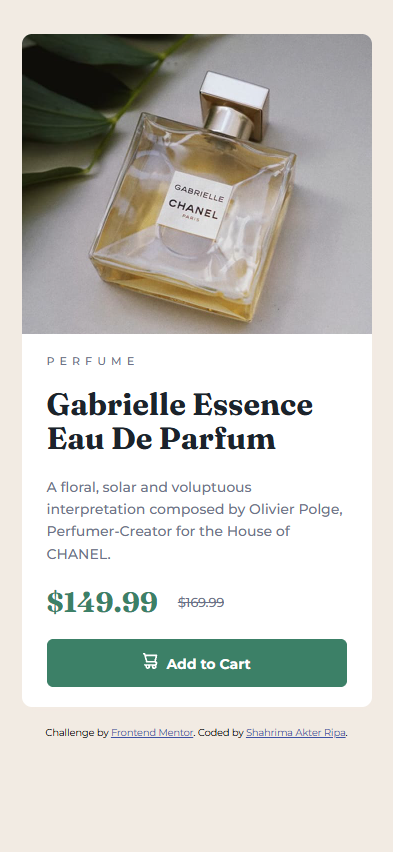

# Frontend Mentor - Product preview card component solution

This is a solution to the [Product preview card component challenge on Frontend Mentor](https://www.frontendmentor.io/challenges/product-preview-card-component-GO7UmttRfa).

I built this project to practice HTML and CSS, improve my responsive design skills, and understand how to recreate a design for different screen size

### The challenge

Users should be able to:

1. View the product card in a responsive layout on different screen sizes.

2. See hover and active states for the Add to Cart button.

3. View the product image and product information clearly on desktop and mobile devices.

### Links

- Solution URL: https://github.com/ripa221/product-preview-card-component-main 
- Live Site URL: https://ripa221.github.io/product-preview-card-component-main/

## My process

1. I started by analyzing the design and identifying its main elements: the product image, product information, pricing, and Add to Cart button.

2. I then structured the content using HTML and used CSS to recreate the layout, typography, colors, spacing, and responsive behavior.

3. I tested the layout at different viewport widths and adjusted the CSS to make the card work on both desktop and mobile devices.

### Built with

- Semantic HTML5 markup
- CSS custom properties
- Flexbox
- CSS media queries
- Responsive image sizing
- Google Fonts
- Mobile and desktop image assets
- Git and GitHub

### What I learned

This project helped me strengthen my understanding of CSS layout, responsive images, and the relationship between parent and child elements.

1. Understanding Flexbox axes:
I learned that justify-content controls the main axis and align-items controls the cross axis. The direction of these axes depends on flex-direction.

2. Building responsive layouts:
I practiced changing the layout from a row on desktop to a column on mobile using a media query.

3. Handling desktop and mobile images:
I learned how to show different image assets at different viewport widths using CSS display properties and media queries.

/* Desktop & Mobile Image Section */
.product-image {
  width: 50%;
}

.mobile-img {
  display: none;
}

4. Understanding image sizing:
I practiced controlling image width and height and learned how object-fit: cover can crop an image while preserving its proportions.

5. Understanding spacing:
I practiced using gap to control spacing between flex items and padding to create space between content and its container edges.

6. Using CSS custom properties:
I used custom properties to organize the project's color palette and make repeated values easier to maintain.

### Challenges and Solutions

One of my main challenges was displaying the correct product image on desktop and mobile.

Initially, the mobile image did not appear because it was hidden by a CSS rule. I learned to check whether the image was being hidden by CSS and whether the image path was correct.

Another challenge was making the desktop image fill its intended area without affecting the mobile layout. I learned to investigate the dimensions of both the image and its parent container.

These challenges helped me understand that responsive debugging requires checking the entire layout rather than changing properties randomly.

### Continued development

I want to continue improving my skills in:

1. Responsive layouts and breakpoints
2. Flexbox and CSS Grid
3. Responsive image behavior
4. Semantic HTML and accessibility
5. CSS maintainability
6. Browser DevTools and systematic debugging

I also plan to revisit this project later and add JavaScript functionality as I continue learning JavaScript.

### Useful resources

1. Frontend Mentor — For practical frontend challenges and design practice.

2. MDN Web Docs: CSS Flexbox — For understanding Flexbox layout.

3. MDN Web Docs: Responsive Design — For learning responsive layout techniques.

4. MDN Web Docs: CSS object-fit — For understanding how images fit inside their containers.

### AI Collaboration

I used ChatGPT as a learning and debugging assistant during this project.

I used it to:

1. Understand CSS concepts such as Flexbox axes, clamp(), spacing, and responsive image sizing.

2. Investigate problems with desktop and mobile image layouts.

3. Receive hints and explanations instead of relying only on ready-made solutions.

4. Improve my understanding of how CSS properties affect parent and child elements.

5. I used these explanations to investigate issues and make adjustments to my own code. This experience helped me practice problem-solving while continuing to build my HTML and CSS skills.

## Author

Frontend Mentor — @ripa221

GitHub — https://github.com/ripa221

